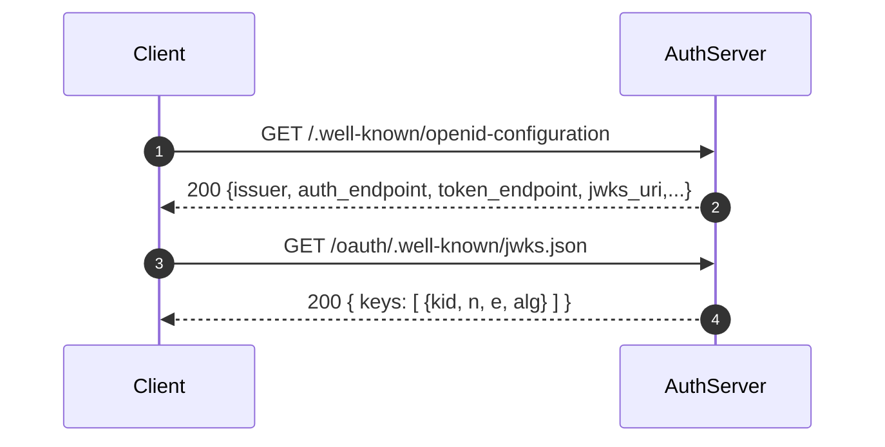
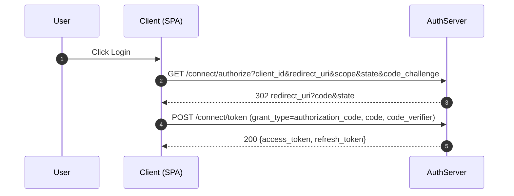
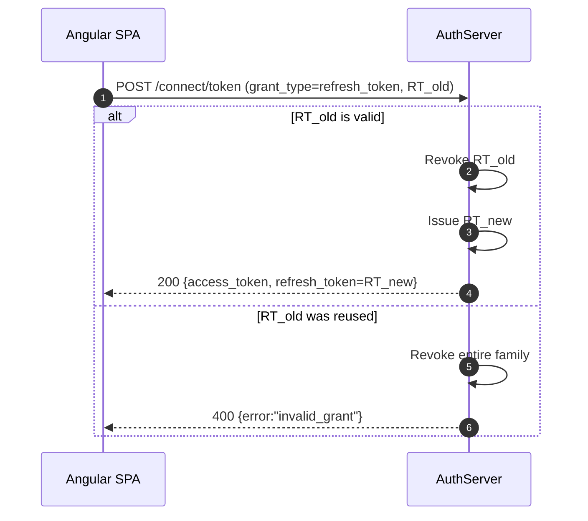
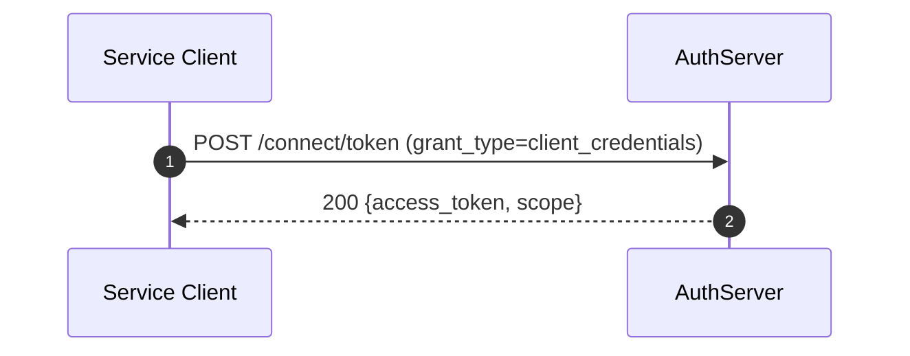

# AuthServer — OAuth 2.0 Authorization Server

This project implements the **Authorization Server** role in OAuth 2.0, built from scratch with .NET 9.  
It issues tokens, manages clients, supports discovery & JWKS, and enforces PKCE and refresh token rotation.

---

## Overview

- **Language**: .NET 9 Web API
- **Responsibilities**:
  - Authenticate and authorize clients
  - Issue Access & Refresh Tokens
  - Support Authorization Code + PKCE, Client Credentials, and Refresh flows
  - Provide Discovery (`.well-known/openid-configuration`) and JWKS (`/jwks.json`)
  - Manage registered OAuth clients

---

## RFC Mapping

- **§1.2 Protocol Flow**  
  `/connect/authorize` issues authorization codes.  
  `/connect/token` issues tokens.  

- **§1.4 Access Token / §1.5 Refresh Token**  
  Access tokens = JWTs (RS256).  
  Refresh tokens = opaque, rotated, reuse-detected.  

- **§2 Client Registration**  
  Stored in DB (`OAuthClient` entity).  
  Admin endpoints allow registering test clients.  

- **§3 Protocol Endpoints**  
  - `/connect/authorize` (GET)  
  - `/connect/token` (POST)  
  - `/.well-known/openid-configuration`  
  - `/oauth/.well-known/jwks.json`  

- **§4 Grants**  
  - Authorization Code (with PKCE required for public clients)  
  - Client Credentials (confidential only)  
  - Refresh Tokens (rotation + narrowing)  
  - Implicit / Password → not implemented  

- **§5 Token Responses**  
  Include `Cache-Control: no-store` and `Pragma: no-cache`.  
  Errors follow RFC (`invalid_request`, `invalid_client`, etc).  

---

## Key Files

- `Program.cs` — Service registration, EF Core, Swagger, CORS, keypair generation  
- `Endpoints/AuthorizeEndpoint.cs` — Handles `/connect/authorize`  
- `Endpoints/TokenEndpoint.cs` — Handles `/connect/token`  
- `Logic/TokenService.cs` — Issues JWTs, refresh rotation, reuse detection  
- `Security/RsaKeyStore.cs` — Manages RSA dev keypair  
- `Infrastructure/AuthDbContext.cs` — EF Core context for clients, codes, tokens  

---

## Sequence Diagrams

### Discovery & JWKS


### Authorization Code + PKCE


### Refresh Token Rotation


### Client Credentials


---

## Testing with Postman

### 1. Environment Variables
```text
as_issuer=http://localhost:5018
auth_endpoint={{as_issuer}}/connect/authorize
token_endpoint={{as_issuer}}/connect/token
jwks_uri={{as_issuer}}/oauth/.well-known/jwks.json
client_id_spa=demo-spa
redirect_uri_spa=http://localhost:4200/callback
scope_spa=weather.read
client_id_svc=demo-service
client_secret_svc=secret123
```

### 2. Authorization Code Flow (PKCE)
1. In Postman, set up OAuth 2.0 with PKCE (S256).  
2. Auth URL = `{{auth_endpoint}}`, Token URL = `{{token_endpoint}}`.  
3. Callback URL = registered redirect (SPA or Postman).  
4. Obtain `access_token` + `refresh_token`.  

### 3. Refresh Token
```http
POST {{token_endpoint}}
Content-Type: application/x-www-form-urlencoded

grant_type=refresh_token
refresh_token=<refresh_token>
```

### 4. Client Credentials
```http
POST {{token_endpoint}}
Authorization: Basic base64(client_id:client_secret)
Content-Type: application/x-www-form-urlencoded

grant_type=client_credentials
scope=weather.read
```

---

## Security Notes

- PKCE is enforced for public clients.  
- Refresh tokens are rotated & family-revoked on reuse.  
- JWTs are signed with RSA keypair; JWKS allows validation by APIs.  
- All responses are marked `no-store` to prevent caching.  
- Error responses follow RFC 6749 & 6750 guidelines.  

---

## References
- [RFC 6749: OAuth 2.0 Authorization Framework](https://datatracker.ietf.org/doc/html/rfc6749)  
- [RFC 6750: Bearer Token Usage](https://datatracker.ietf.org/doc/html/rfc6750)  
- [RFC 7517: JSON Web Key (JWK)](https://datatracker.ietf.org/doc/html/rfc7517)  
- [RFC 8414: OAuth 2.0 Authorization Server Metadata](https://datatracker.ietf.org/doc/html/rfc8414)  
