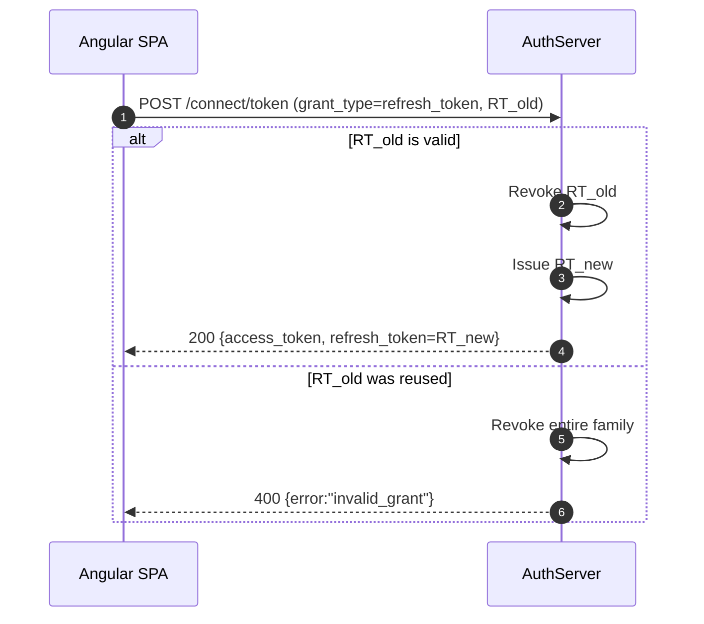
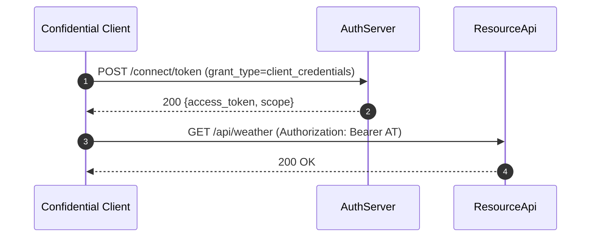
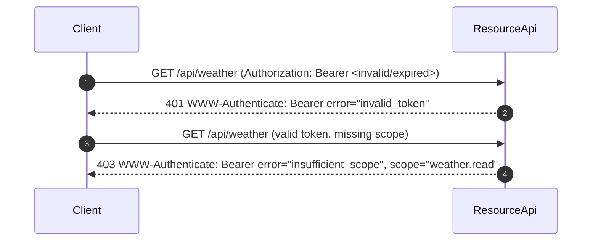

# Generation 1: OAuth 2.0 from scratch

Generation 1 of [oauth2-identity-lab](../README.md). It is an OAuth 2.0 authorization server and protected API written **by hand** on .NET 9 with no OAuth server library, so I could learn the protocol by implementing it. It follows [RFC 6749], [RFC 6750], [RFC 7517] and [RFC 7636] (PKCE), and serves an OpenID-style discovery document.

It consists of three applications:

- **AuthServer** (`AuthServer/`): the authorization server. It issues tokens, manages clients, and serves discovery and JWKS.
- **ResourceApi** (`ResourceApi/`): the resource server. It validates tokens, enforces scope and returns RFC 6750 errors.
- **[Angular SPA](https://github.com/HariVenkataKrishnaKotha/oauth2-pkce-angular-client)** (separate repo): the public client. It runs Authorization Code + PKCE, stores and refreshes tokens, and calls the API.

> Learning lab, not production. `/connect/authorize` does not log anyone in: it issues codes for the seeded user `alice`. Tokens are logged to the console, and everything runs over HTTP. The full list is under [Security notes](../README.md#security-notes) in the root README.

---

## RFC mapping overview

### AuthServer
- §1.2 Flow: `/connect/authorize` + `/connect/token`
- §1.4 / §1.5: access token (RS256 JWT, 10 min) and refresh token (opaque, 30 days)
- §3 Endpoints: discovery (`/oauth/.well-known/openid-configuration`) and JWKS (`/oauth/.well-known/jwks.json`)
- §4.1 Authorization Code Grant with PKCE (S256 required for public clients; Implicit `response_type=token` rejected)
- §4.4 Client Credentials (`client_secret_basic` or `client_secret_post`)
- §6 Refresh Tokens (rotation, reuse detection with family revocation, scope narrowing)

### ResourceApi
- §7 Accessing Protected Resources (`GET /api/weather`, scope `weather.read`)
- RFC 6750: Bearer token usage, `WWW-Authenticate` error headers

### Angular SPA
- §4.1 Auth Code + PKCE implementation
- §7 Calling APIs with `Authorization: Bearer`

---

## High-level sequence diagrams

### Authorization Code + PKCE flow

```mermaid
sequenceDiagram
  autonumber
  participant U as User
  participant SPA as Angular SPA (Client)
  participant AS as AuthServer
  participant RS as ResourceApi

  U->>SPA: Click "Sign in"
  SPA->>SPA: Generate state + code_verifier + code_challenge(S256)
  SPA->>AS: GET /connect/authorize?...&code_challenge
  Note over AS: Dev shortcut: no login screen, code issued for seeded user "alice"
  AS-->>SPA: 302 redirect_uri?code&state
  SPA->>AS: POST /connect/token (code + code_verifier)
  AS-->>SPA: 200 {access_token, refresh_token}
  SPA->>RS: GET /api/weather (Authorization: Bearer AT)
  RS-->>SPA: 200 OK (payload)
```


### Refresh token rotation and reuse detection


### Client credentials flow


### ResourceApi error handling (RFC 6750)


---

## Run it

Full steps, including the dev-secret commands, are in the root README under [Quick start: generation 1](../README.md#quick-start-generation-1). In short:

```powershell
cd 01-from-scratch/AuthServer
dotnet user-secrets init
dotnet user-secrets set "ConnectionStrings:AuthDb" "Server=localhost;Database=AuthDb;Trusted_Connection=True;TrustServerCertificate=True"
dotnet run --launch-profile http     # http://localhost:5018, migrates + seeds on startup

cd ../ResourceApi
dotnet run --launch-profile http     # http://localhost:5173
```

Use the `http` profile: the issuer is hard-coded to `http://localhost:5018`.

**Existing databases:** the seeder stores `demo-spa`'s redirect URIs as the JSON array `["http://localhost:4200/callback"]`, which `/connect/authorize` parses. Older versions stored the plain string `localhost:4200/callback`, and the seeder skips `demo-spa` once the row exists. If your `AuthDb` predates the fix, delete the row and restart `AuthServer` to reseed it, or recreate the database:

```sql
DELETE FROM OAuthClients WHERE ClientId = N'demo-spa';
```

---

## How to test with Postman

1. **Environment** variables:
   - `as_issuer=http://localhost:5018`
   - `token_endpoint={{as_issuer}}/connect/token`
   - `auth_endpoint={{as_issuer}}/connect/authorize`
   - `jwks_uri={{as_issuer}}/oauth/.well-known/jwks.json`
   - `rs_base=http://localhost:5173`
   - `client_id_spa=demo-spa`, `redirect_uri_spa=http://localhost:4200/callback`, `scope_spa=weather.read`
   - `client_id_svc=demo-spa`, `client_secret_svc=svc-secret-very-strong` (seeded dev credentials; `demo-spa` is registered as confidential)

2. **Auth Code + PKCE**
   - Use Postman's OAuth 2.0 helper (Authorization Code with PKCE, S256), with a callback URL that is registered for the client.
   - Inspect `access_token` + `refresh_token`.
   - Note: `demo-spa` is seeded as a confidential client, and the server only enforces PKCE for public clients, so it does not require PKCE for `demo-spa`. See [Security notes](../README.md#security-notes).

3. **Refresh tokens**
   - POST to `{{token_endpoint}}` with `grant_type=refresh_token`. Add `scope` to narrow it.

4. **Client credentials**
   - POST to `{{token_endpoint}}` with Basic auth (`client_secret_basic`) or form fields (`client_secret_post`).

5. **ResourceApi**
   - Call `GET {{rs_base}}/api/weather` with `Authorization: Bearer {{access_token}}`.

To register more clients, use the loopback-only admin endpoints: `POST /admin/clients/register`, `GET /admin/clients/` and `POST /admin/clients/{clientId}/rotate-secret`.

---

## Solution structure

```
01-from-scratch/
├── OAuthFromScratch.sln
├── AuthServer/        # Authorization server (.NET 9 minimal APIs, EF Core, SQL Server)
└── ResourceApi/       # Protected resource API (.NET 9 minimal APIs)
```

The Angular SPA lives in its own repo: [oauth2-pkce-angular-client](https://github.com/HariVenkataKrishnaKotha/oauth2-pkce-angular-client).

---

## References
- [RFC 6749: OAuth 2.0 Authorization Framework](https://datatracker.ietf.org/doc/html/rfc6749)
- [RFC 6750: Bearer Token Usage](https://datatracker.ietf.org/doc/html/rfc6750)
- [RFC 7517: JSON Web Key (JWK)](https://datatracker.ietf.org/doc/html/rfc7517)
- [RFC 7636: Proof Key for Code Exchange (PKCE)](https://datatracker.ietf.org/doc/html/rfc7636)
- [RFC 8414: OAuth 2.0 Authorization Server Metadata](https://datatracker.ietf.org/doc/html/rfc8414)

[RFC 6749]: https://datatracker.ietf.org/doc/html/rfc6749
[RFC 6750]: https://datatracker.ietf.org/doc/html/rfc6750
[RFC 7517]: https://datatracker.ietf.org/doc/html/rfc7517
[RFC 7636]: https://datatracker.ietf.org/doc/html/rfc7636
