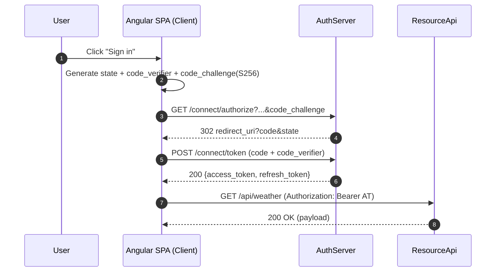
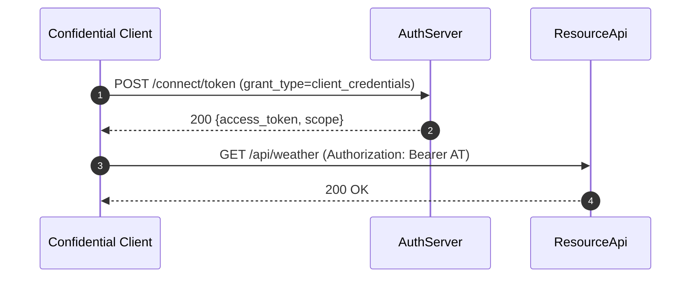
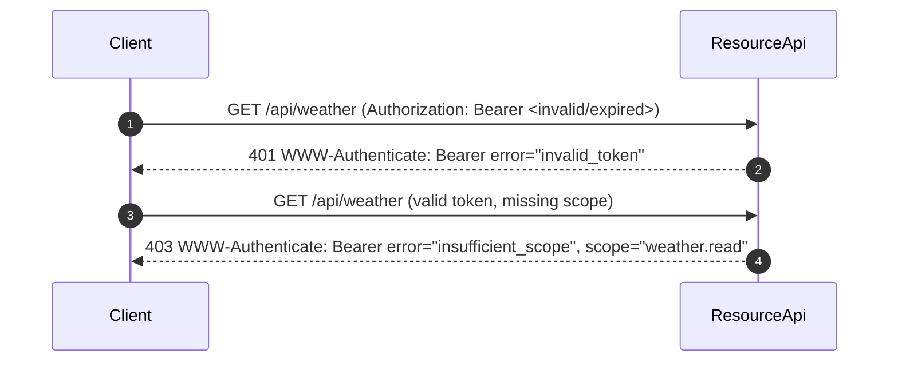

# OAuthServerFromScratch — End-to-End OAuth 2.0 Solution

This solution demonstrates building an OAuth 2.0 ecosystem **from scratch** using .NET 9 + Angular 20, fully aligned with [RFC 6749], [RFC 6750], [RFC 8414], and [RFC 7517].

It consists of three applications:

- **AuthServer** — Authorization Server (issues tokens, manages clients)
- **ResourceApi** — Resource Server (validates tokens, enforces scope, RFC 6750-compliant errors)
- **[Angular SPA](https://github.com/HariVenkataKrishnaKotha/GlobalClientAngular)** — Public Client (Authorization Code + PKCE, token storage, refresh, API calls)

---

## RFC Mapping Overview

### AuthServer
- §1.2 Flow: `/connect/authorize` + `/connect/token`
- §1.4 / §1.5: Access (JWT) & Refresh (opaque)
- §3 Endpoints: discovery (`/.well-known/openid-configuration`) & JWKS
- §4.1 Auth Code Grant (with PKCE)
- §4.4 Client Credentials
- §4.6 Refresh Tokens (rotation + reuse detection)

### ResourceApi
- §7 Accessing Protected Resources
- RFC 6750: Bearer token usage, `WWW-Authenticate` error headers

### Angular SPA
- §4.1 Auth Code + PKCE implementation
- §7 Calling APIs with `Authorization: Bearer`

---

## High-Level Sequence Diagrams

### Authorization Code + PKCE Flow


### Refresh Token Rotation & Reuse Detection
```mermaid
sequenceDiagram
  autonumber
  participant SPA as Angular SPA
  participant AS as AuthServer

  SPA->>AS: POST /connect/token (grant_type=refresh_token, RT_old)
  alt Valid & not revoked
    AS->>AS: Revoke RT_old; issue RT_new
    AS-->>SPA: 200 {access_token, refresh_token=RT_new}
  else Reuse attempt
    AS->>AS: Revoke family
    AS-->>SPA: 400 {error:"invalid_grant"}
  end
```

### Client Credentials Flow


### ResourceApi Error Handling (RFC 6750)


---

## How to Test with Postman

1. **Environment** variables:
   - `as_issuer=http://localhost:5018`
   - `token_endpoint={{as_issuer}}/connect/token`
   - `auth_endpoint={{as_issuer}}/connect/authorize`
   - `rs_base=http://localhost:5173`
   - `client_id_spa`, `redirect_uri_spa`, `scope_spa`
   - `client_id_svc`, `client_secret_svc` (for CC)

2. **Auth Code + PKCE**
   - Use Postman OAuth helper (Authorization Code (PKCE)).
   - Inspect `access_token` + `refresh_token`.

3. **Refresh Tokens**
   - POST to `{{token_endpoint}}` with `grant_type=refresh_token`.

4. **Client Credentials**
   - POST to `{{token_endpoint}}` with Basic auth or client_secret_post.

5. **ResourceApi**
   - Call `GET {{rs_base}}/api/weather` with `Authorization: Bearer {{access_token}}`.

---

## Solution Structure

```
OAuthServerFromScratch/
├── AuthServer/        # Authorization Server (.NET 9 Web API)
├── ResourceApi/       # Protected Resource API (.NET 9 Web API)
└── angular-client/    # Angular SPA (public client)
```

---

## References
- [RFC 6749: OAuth 2.0 Authorization Framework](https://datatracker.ietf.org/doc/html/rfc6749)
- [RFC 6750: Bearer Token Usage](https://datatracker.ietf.org/doc/html/rfc6750)
- [RFC 7517: JSON Web Key (JWK)](https://datatracker.ietf.org/doc/html/rfc7517)
- [RFC 8414: OAuth 2.0 Authorization Server Metadata](https://datatracker.ietf.org/doc/html/rfc8414)
