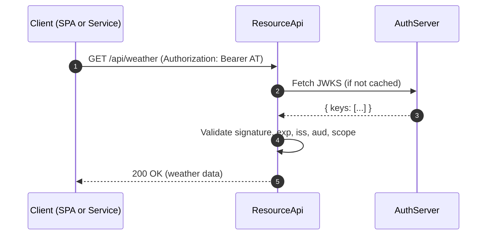
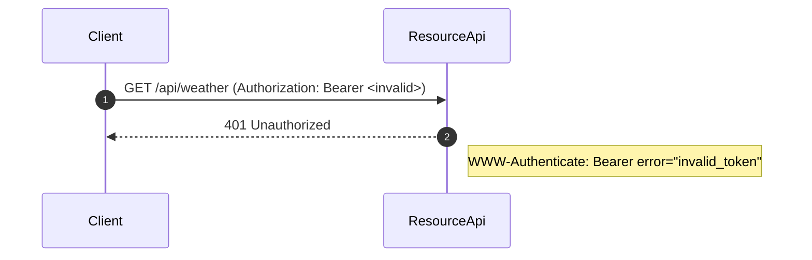
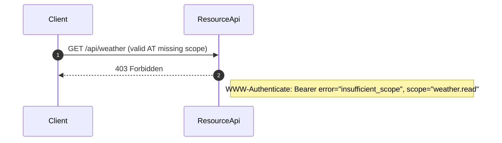

# ResourceApi — OAuth 2.0 Protected Resource

This project implements the **Resource Server** role in OAuth 2.0, built with .NET 9.  
It validates JWT access tokens against AuthServer’s JWKS and enforces scopes according to RFC 6750.

---

## Overview

- **Language**: .NET 6 Web API  
- **Responsibilities**:
  - Protect resources using Bearer tokens
  - Validate JWT signatures, issuer, audience, expiry
  - Enforce required scopes on each API endpoint
  - Emit RFC 6750-compliant `WWW-Authenticate` error responses

---

## RFC Mapping

- **RFC 6749 §7 Accessing Protected Resources**  
  Implements secured API endpoints with token checks.  

- **RFC 6750 (Bearer Token Usage)**  
  - `Authorization: Bearer <access_token>` expected on each request  
  - `401` → `invalid_token`  
  - `403` → `insufficient_scope`  

- **RFC 7517 (JWK)**  
  Uses AuthServer’s `/jwks.json` to validate JWTs (RS256).  

---

## Key Files

- `Program.cs` — Configures JWT Bearer authentication, adds custom error handling.  
- `Services/JwksProvider.cs` — Fetches JWKS from AuthServer.  
- `Services/JwksRefreshService.cs` — Periodically refreshes JWKS.  
- `Security/ScopeRequirement.cs` — Defines required scopes.  
- `Security/RequiredScopesMetadata.cs` — Applies scope checks to endpoints.  
- `Controllers/WeatherController.cs` — Example protected API endpoint (`/api/weather`).  

---

## Sequence Diagrams

### Successful Access


### Invalid / Expired Token


### Insufficient Scope


---

## Testing with Postman

### 1. Environment Variables
```text
rs_base=http://localhost:5173
as_issuer=http://localhost:5018
token_endpoint={{as_issuer}}/connect/token
client_id_spa=demo-spa
scope_spa=weather.read
```

### 2. Obtain Access Token (from AuthServer)
- Use SPA flow (Authorization Code + PKCE) **or** Client Credentials.  
- Copy the `access_token`.  

### 3. Call Protected Resource
```http
GET {{rs_base}}/api/weather
Authorization: Bearer {{access_token}}
```

- **200 OK** → valid token with correct scope.  
- **401 Unauthorized** → invalid/expired token.  
- **403 Forbidden** → missing `weather.read` scope.  

---

## Security Notes

- JWKS fetched securely from AuthServer.  
- Validates issuer (`iss`), audience (`aud`), expiration (`exp`).  
- Adds scope enforcement per endpoint.  
- RFC 6750-compliant error responses include `WWW-Authenticate` headers.  
- `Cache-Control: no-store` on error responses prevents caching of sensitive details.  

---

## References
- [RFC 6749: OAuth 2.0 Authorization Framework](https://datatracker.ietf.org/doc/html/rfc6749)  
- [RFC 6750: Bearer Token Usage](https://datatracker.ietf.org/doc/html/rfc6750)  
- [RFC 7517: JSON Web Key](https://datatracker.ietf.org/doc/html/rfc7517)  
