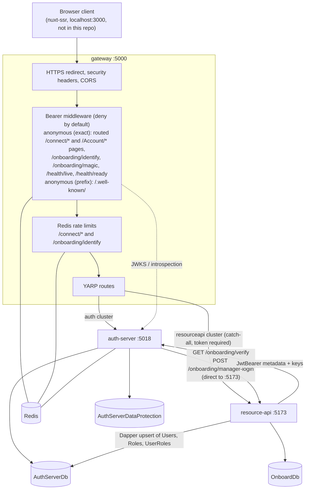
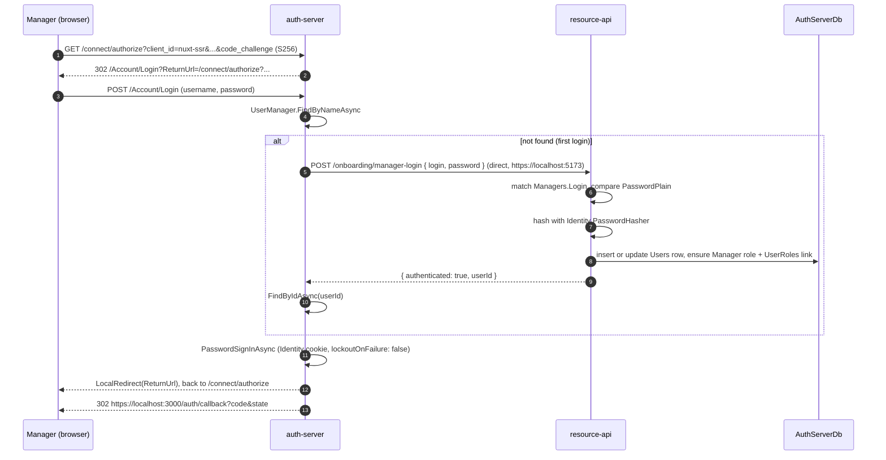

# Generation 2: gateway platform

Generation 2 of [oauth2-identity-lab](../README.md) rebuilds the hand-written OAuth server from [generation 1](../01-from-scratch/README.md) the way a real platform would be put together:

- **auth-server:** an OpenIddict 7.1 authorization server on ASP.NET Core Identity, with Razor login and enrollment pages and passwordless onboarding.
- **gateway:** a YARP reverse proxy, the single entry point for every app, that validates access tokens through JWKS or OAuth introspection, rate-limits sensitive endpoints with Redis, and forwards identity headers.
- **resource-api:** the protected API for an employee onboarding scenario: managers review their new hires, and new hires verify their identity and enroll without a pre-issued password.

> Learning lab, not production. See [Security notes](../README.md#security-notes) in the root README for every dev-only shortcut in this folder and what a production version would do instead.

---

## Contents

- [Components](#components)
- [Architecture](#architecture)
- [Flows](#flows)
  - [Manager login](#1-manager-login)
  - [Onboardee passwordless onboarding and enrollment](#2-onboardee-passwordless-onboarding-and-enrollment)
  - [Token issuance](#3-token-issuance)
  - [Gateway token validation: JWKS vs introspection](#4-gateway-token-validation-jwks-vs-introspection)
- [Endpoints](#endpoints)
- [Run it](#run-it)
- [Configuration](#configuration)
- [Known gaps](#known-gaps)

---

## Components

| Service | Port (`https` profile) | Stack | Responsibility |
|---|---|---|---|
| `auth-server/` | `https://localhost:5018` (http 5019) | .NET 9, OpenIddict 7.1.0, ASP.NET Core Identity + EF Core 9 (SQL Server), Data Protection on EF Core, StackExchange.Redis 2.9.32, Razor Pages | Issues tokens; hosts login and enrollment UI; runs the passwordless identify/magic-link steps |
| `gateway/` | `https://localhost:5000` (http 5001) | .NET 9, Yarp.ReverseProxy 2.3.0, Microsoft.IdentityModel.Tokens / System.IdentityModel.Tokens.Jwt 8.14.0, Redis cache, OpenTelemetry 1.12–1.13 | Single front door; routes to auth-server or resource-api; validates bearer tokens; rate-limits; adds security headers |
| `resource-api/` | `https://localhost:5173` (http 5174) | .NET 9, JwtBearer 9.0.10, EF Core 9 (SQL Server), Dapper 2.1.66, Swashbuckle 9.0.6 | Onboarding data (managers, onboardees), badge approval; provisions users into the identity store |
| Redis | `localhost:6379` | | Verify sessions, rate-limit counters, JWKS cache, introspection cache |
| SQL Server | | | `AuthServerDb`, `AuthServerDataProtection`, `OnboardDb` |

Seeded data:

| Where | What |
|---|---|
| auth-server `Infrastructure/Seed.cs` | Roles `Manager` and `Onboardee`. Public client `nuxt-ssr` (code + refresh, PKCE required, redirects `http(s)://localhost:3000/auth/callback`). Confidential client `yarp-gateway` (introspection + revocation, secret `dev-only-change-me`). Scopes `onboarding.read` and `onboarding.write` (resource `resource-api`) |
| resource-api `Data/Seed.cs` | Managers `manager1@example.com` and `manager2@example.com` (password `P@ssw0rd!123`, plaintext test field); onboardees Ava Johnson (1995-03-12), Liam Johnson (1999-09-01), Maya Patel (2000-01-25) |

---

## Architecture



### Gateway routes (`gateway/appsettings.json`)

| Route | Match | Cluster |
|---|---|---|
| `connect-authorize`, `connect-token`, `connect-introspect`, `connect-userinfo` | `/connect/authorize`, `/connect/token`, `/connect/introspect`, `/connect/userinfo` | `auth` → `https://localhost:5018/` |
| `account-login`, `account-enroll` | `/Account/Login`, `/Account/Enroll` | `auth` |
| `well-known` | `/.well-known/{**remainder}` | `auth` |
| `onboarding-identify`, `onboarding-magic` | `/onboarding/identify`, `/onboarding/magic` | `auth` |
| `api-routes` | `/{**remainder}` (everything else) | `resourceapi` → `https://localhost:5173/` |

The catch-all is intentional. I built the gateway as one unified entry route that every app goes through, and I checked bottlenecks and bandwidth limits and found it sufficient for the number of apps it had to serve.

No path transforms are configured, so resource-api paths are reached unchanged through the gateway (for example `https://localhost:5000/onboarding/list`). The literal auth-server routes and the gateway's own endpoints (`/health/live`, `/health/ready`, `/test-token`) take precedence over the catch-all. Everything else, including resource-api's `/internal/sync/*` and `/swagger`, goes to resource-api and needs a valid Bearer token at the gateway.

### Gateway anonymous paths (`gateway/Program.cs`)

The bearer middleware denies by default. Only these paths pass without a token:

| Path | Match | Why it must be anonymous |
|---|---|---|
| `/onboarding/identify` | exact | Passwordless step 1 (last name + date of birth). The new hire has no token yet. Rate limited at the gateway and at auth-server |
| `/onboarding/magic` | exact | Passwordless step 2: redeems the one-time verify session and sets the auth-server cookie. Still no token |
| `/connect/authorize`, `/connect/token`, `/connect/introspect`, `/connect/userinfo` | exact | OpenIddict endpoints. These authenticate the caller themselves (cookie, client credentials, PKCE) |
| `/Account/Login`, `/Account/Enroll` | exact | Login and enrollment pages (cookie-based). Both post back to the same path; neither uses sub-paths or static assets under `/Account/` |
| `/.well-known/` | prefix | Discovery document and JWKS (all public data) |
| `/health/live`, `/health/ready` | exact | The gateway's own probes |

Matching ignores case. Exact entries mirror the `auth` routes in `gateway/appsettings.json`, so a new auth-server route must be added to both. Everything else, including everything the catch-all sends to resource-api, needs a valid Bearer token. That includes auth-server endpoints the gateway does not route, such as `/connect/revocation`, `/connect/endsession` and `/Account/logout`.

---

## Flows

### 1. Manager login

Managers exist first only in the onboarding database. On first sign-in, auth-server provisions them into ASP.NET Core Identity.



On later sign-ins the user already exists in `AuthServerDb`, so the password is checked by Identity alone.

### 2. Onboardee passwordless onboarding and enrollment

A new hire has no account. They prove who they are with last name + date of birth (optionally their onboarding id), get a one-time verify session, then set an email and password.

```mermaid
sequenceDiagram
    autonumber
    participant U as New hire (browser)
    participant GW as gateway
    participant AS as auth-server
    participant RA as resource-api
    participant R as Redis

    U->>GW: POST /onboarding/identify { lastName, birthDate, onboardId? }
    GW->>GW: rate limit rl:identify:{ip} (20 per 300 s)
    GW->>AS: forward (route onboarding-identify)
    AS->>R: rate limit rl:identify:{ip} (20 per 5 min)
    AS->>RA: GET /onboarding/verify?lastName&dob&onboardId
    RA->>RA: match Onboardees (LastName, BirthDate[, Id])
    RA->>RA: provision Identity user (Id = onboardId, onboardee-{id}@local, role Onboardee) via Dapper
    RA-->>AS: { matched: true, onboardId }
    AS->>AS: ensure temp user exists (create + Onboardee role if missing)
    AS->>R: SET verifysess:{random 128-bit hex} (TTL 10 min)
    AS-->>U: 200 { verifySessionId, delivery: "link", expiresAt }
    Note over AS,U: The link is not emailed or texted yet (TODO in code); the id comes back in the response
    U->>GW: GET /onboarding/magic?vs={id}&redirect={/connect/authorize?...}
    GW->>AS: forward (route onboarding-magic)
    AS->>R: GET then DEL verifysess:{id} (one-time)
    AS->>AS: sign in with Identity cookie (non-persistent)
    AS-->>U: 302 /Account/Enroll?returnUrl={redirect}
    U->>AS: POST /Account/Enroll { email, password (min 8) }
    AS->>AS: set UserName = Email, EmailConfirmed = true, AddPasswordAsync, RefreshSignInAsync
    AS-->>U: 302 returnUrl, then /connect/authorize, then code to redirect_uri
```

The `role=Onboardee` access token also carries an `onboard_id` claim. A returning onboardee signs in at `/Account/Login` with the email and password set during enrollment.

`POST /onboarding/verify-code` (a numeric OTP alternative) exists as a stub that returns `not_implemented`.

### 3. Token issuance

`/connect/authorize` and `/connect/token` use OpenIddict's passthrough mode, so the logic lives in `Controllers/AuthorizationController.cs`:

- **Authorize** (`[Authorize]`, so it challenges to `/Account/Login`) builds a principal with these claims:

  | Claim | When | Destinations |
  |---|---|---|
  | `sub`, `name` | always | access token + ID token |
  | `role` | per Identity role | access token + ID token |
  | `onboard_id` | role `Onboardee` with an `OnboardId` | access token only |
  | `perm=badge_approve` | role `Manager` | access token only |

  Requested scopes are filtered to `openid`, `profile`, `email`, `offline_access`, `onboarding.read` and `onboarding.write`. The resource (audience) is set to `resource-api`.
- **Token** handles `authorization_code` and `refresh_token`. OpenIddict validates the code, PKCE verifier and client. On refresh, the controller reloads the user's roles and claims from the database and takes scopes from the refresh request (`request.GetScopes()`).
- **Server settings** (`Program.cs`): issuer from `OpenIddict:Issuer` (`https://localhost:5000/`, the gateway); PKCE required; access tokens 10 minutes; refresh tokens 30 days; access-token encryption disabled, so access tokens are signed JWTs; ephemeral signing and encryption keys.

### 4. Gateway token validation: JWKS vs introspection

Every request whose path is **not** on the [anonymous list](#gateway-anonymous-paths-gatewayprogramcs) must carry `Authorization: Bearer ...`. A missing token gets 401 `missing_bearer`; a token that fails validation gets 401 `invalid_token` with a `reason`. On success the gateway sets `HttpContext.User` and adds `X-Auth-Source`, `X-Request-Id`, `X-Forwarded-UserId` and `X-Forwarded-Roles` before proxying.

`Auth/TokenAuthenticator.cs` chooses the strategy from `Gateway:ValidationMode`:

| Mode | Behaviour | Network cost per request | Sees revocation? |
|---|---|---|---|
| `JwtOnly` (**committed default**) | Validate signature, issuer, audience and lifetime locally with keys from `Gateway:JwksUri` | None on a cache hit (JWKS cached in Redis for 1 h) | No; a token is valid until `exp` |
| `JwtFirst` (default if the key is unset) | JWT validation; if it fails (for example, not a JWT), fall back to introspection | Introspection only on fallback | Only for tokens that reach the fallback |
| `IntrospectionOnly` | `POST /connect/introspect` with `yarp-gateway` Basic credentials | One call per token, then cached | Only on first sight; see below |
| `PreferIntrospection` | Introspection first; fall back to local JWT validation if it fails | One call per token, then cached | As above, falling back to JWT when the auth server is unavailable |

When each one fits, based on how the code behaves:

- **JWKS (local JWT validation)** is the fast path for self-contained JWTs. auth-server uses **ephemeral** keys, so a restart changes the signing key. The authenticator handles this: on `SecurityTokenSignatureKeyNotFoundException` it invalidates the cached JWKS, refetches and retries once.
- **Introspection** is for opaque/reference tokens, or when the gateway must ask the auth server whether a token is still active. In this code, introspection responses are cached in Redis until the token's `exp` (5 minutes when `exp` is absent). So a token revoked after its first introspection is still accepted from cache until it expires.

Two more gateway behaviours sit next to validation:

- **Rate limiting** (`Auth/RedisRateLimiter.cs`): Redis `INCR` + `EXPIRE` on the first hit, which is a fixed window. `/connect/*` is limited to 60 per 60 s per IP; `/onboarding/identify` to 20 per 300 s per IP. Both return 429 with `Retry-After`.
- **Security headers:** `X-Content-Type-Options: nosniff`, `X-Frame-Options: DENY` and `Referrer-Policy: no-referrer` on every response. Hop-by-hop headers are stripped before forwarding.

The resource API validates tokens itself as well, with `JwtBearer`: Authority `https://localhost:5018/`, audience `resource-api`, 60 s clock skew. It then authorizes with `[Authorize]`, the `ManagerOnly` role policy, and a `perm=badge_approve` check inside the badge-approval action.

> **Defence in depth.** A call such as `GET /onboarding/list` is checked twice: the gateway validates the token, then resource-api's `JwtBearer` validates it again. Only resource-api checks roles and permissions; the gateway's `ApiDefault` and `ManagerWrite` policies are not wired in (see [Known gaps](#known-gaps)).
>
> **Likely issuer mismatch (not verified by running).** Tokens carry issuer `https://localhost:5000/` (`OpenIddict:Issuer`), but resource-api's `JwtBearer` expects `https://localhost:5018/`. If so, resource-api will answer 401 even after the gateway accepts the token.

---

## Endpoints

### auth-server (`https://localhost:5018`)

| Method | Path | Auth | Notes |
|---|---|---|---|
| GET, POST | `/connect/authorize` | Identity cookie (`[Authorize]`) | OpenIddict passthrough → `AuthorizationController` |
| POST | `/connect/token` | client per OpenIddict | `authorization_code`, `refresh_token` |
| POST | `/connect/introspect` | confidential client | Handled by OpenIddict |
| POST | `/connect/revocation` | client | Handled by OpenIddict |
| GET, POST | `/connect/endsession` | | URI configured; no custom handler in code |
| GET, POST | `/connect/userinfo` | | Passthrough enabled, but **no action handles it** in the code |
| GET | `/.well-known/openid-configuration`, `/.well-known/jwks` | | OpenIddict defaults (the gateway's `JwksUri` points at `/.well-known/jwks`) |
| GET, POST | `/Account/Login` | anonymous | Razor page |
| GET, POST | `/Account/Enroll` | Identity cookie | Razor page; reached from the magic link |
| POST | `/Account/logout` | Identity cookie | `AccountController` |
| POST | `/onboarding/identify` | anonymous, rate-limited | `{ lastName, birthDate, onboardId? }` |
| GET | `/onboarding/magic?vs=&redirect=` | anonymous | One-time verify session |
| POST | `/onboarding/verify-code` | anonymous | Stub: `not_implemented`. Not routed by the gateway |
| GET | `/health/ready`, `/health/redis` | anonymous | |

### gateway (`https://localhost:5000`)

| Method | Path | Notes |
|---|---|---|
| any | YARP routes | See [Gateway routes](#gateway-routes-gatewayappsettingsjson) |
| GET | `/test-token` | Dev-only: echoes validation source and token claims (after the bearer middleware) |
| GET | `/health/live`, `/health/ready` | `ready` pings Redis |

### resource-api (`https://localhost:5173`)

| Method | Path | Auth | Notes |
|---|---|---|---|
| GET | `/onboarding/verify?lastName&dob&onboardId` | anonymous | Used by auth-server identify; provisions the onboardee into `AuthServerDb` |
| POST | `/onboarding/manager-login` | anonymous | JSON body `{ login, password }`. Used by auth-server on first manager login; plaintext comparison; logs only the login name |
| GET | `/onboarding/list` | `[Authorize]` | Managers get their own onboardees; others get `[]` |
| GET | `/onboarding/{onboardId}` | `[Authorize]` | No ownership check |
| POST | `/onboarding/{onboardId}/badge-approval` | `ManagerOnly` + `perm=badge_approve` | `{ approved: bool }`; demo response, nothing persisted |
| POST | `/internal/sync/manager` | anonymous | `{ login, password }` |
| POST | `/internal/sync/onboardee` | anonymous | `{ lastName, birthDate }` |
| GET | `/health/ready` | anonymous | |
| GET | `/swagger` | anonymous | Enabled in all environments |

"anonymous" here is resource-api's own attribute. Through the gateway's catch-all, every row is reachable, but only with a valid Bearer token, and the gateway does no role or scope check. Every row is reachable without a token by anyone who can connect to port 5173 directly.

---

## Run it

Prerequisites, dev-secret commands and a full manager walkthrough (PKCE pair, authorize URL, token exchange, API call) are in the root README under [Quick start: generation 2](../README.md#quick-start-generation-2). In short:

```powershell
# 0. Redis on localhost:6379, SQL Server reachable, dev cert trusted
dotnet dev-certs https --trust

# 1. Secrets (each project: dotnet user-secrets init first)
#    auth-server : ConnectionStrings:Default, ConnectionStrings:DataProtection
#    resource-api: ConnectionStrings:OnboardingDb, ConnectionStrings:AuthServerDb (same DB as auth-server Default)
#    gateway     : Gateway:Introspection:ClientSecret (only needed for introspection modes)

# 2. Start in this order, always with the https profile
cd auth-server;  dotnet run --launch-profile https   # migrates + seeds AuthServerDb
cd resource-api; dotnet run --launch-profile https   # EnsureCreated + seeds OnboardDb
cd gateway;      dotnet run --launch-profile https
```

**Build note:** all three services build with 0 errors on the .NET 10 SDK (10.0.301), and `auth-server` was also built on SDK 9.0.315. No `global.json` or `LangVersion` override is needed.

### Try the onboardee flow

The URL-encoded `redirect` below is the same authorize request used in the manager walkthrough:

```bash
# 1. Identify as a seeded onboardee
curl -s -X POST https://localhost:5000/onboarding/identify \
  -H "Content-Type: application/json" \
  -d '{"lastName":"Patel","birthDate":"2000-01-25"}'
# -> { "verifySessionId": "...", "delivery": "link", "expiresAt": "..." }
```

```
# 2. Open in a browser (use one session, so the cookie carries through):
https://localhost:5018/onboarding/magic?vs=<verifySessionId>&redirect=<URL-encoded https://localhost:5018/connect/authorize?client_id=nuxt-ssr&response_type=code&redirect_uri=https://localhost:3000/auth/callback&scope=openid%20profile%20onboarding.read&state=s1&code_challenge=<challenge>&code_challenge_method=S256>
```

3. On `/Account/Enroll`, set an email and a password of at least 8 characters.
4. You are redirected through `/connect/authorize` to `https://localhost:3000/auth/callback?code=...`. Exchange the code exactly as in the manager walkthrough.

I tested generation 2 with Postman and the Brave browser. The seeded `nuxt-ssr` client exists because the proof of concept anticipated a Nuxt app as a future client; that app is not in this repo.

---

## Configuration

| Project | Key | Committed value | Notes |
|---|---|---|---|
| auth-server | `ConnectionStrings:Default` | `...AuthServerDb...Password=YOUR_SA_PASSWORD` | Dev secret placeholder |
| auth-server | `ConnectionStrings:DataProtection` | `...AuthServerDataProtection...Password=YOUR_SA_PASSWORD` | Dev secret placeholder |
| auth-server | `OpenIddict:Issuer` | `https://localhost:5000/` | Must match gateway `Gateway:Issuer` |
| auth-server | `Redis:Configuration` | `localhost:6379` | |
| auth-server | `ResourceAPI:BaseUrl` | `https://localhost:5173` | Not read by code |
| gateway | `Gateway:Issuer` | `https://localhost:5000/` | Required |
| gateway | `Gateway:ExpectedAudiences` | `["resource-api"]` | |
| gateway | `Gateway:JwksUri` | `https://localhost:5000/.well-known/jwks` | |
| gateway | `Gateway:ValidationMode` | `JwtOnly` | `JwtOnly` / `JwtFirst` / `IntrospectionOnly` / `PreferIntrospection` |
| gateway | `Gateway:TokenClockSkewSeconds` | `60` | |
| gateway | `Gateway:Introspection:Endpoint` | `https://localhost:5018/connect/introspect` | |
| gateway | `Gateway:Introspection:ClientId` | `yarp-gateway` | |
| gateway | `Gateway:Introspection:ClientSecret` | `dev-only-change-me` | Dev secret placeholder; must match `Seed.cs` |
| gateway | `Redis:Configuration` | `localhost:6379` | |
| gateway | `Redis:IntrospectionCachePrefix` | `introspect:` | |
| gateway | `RateLimiting:*` | `AuthWindowSeconds 60`, `AuthMax 60`, `IdentifyWindowSeconds 300`, `IdentifyMax 20` | |
| gateway | `ReverseProxy:*` | routes and clusters above | Clusters set `DangerousAcceptAnyServerCertificate: true` |
| gateway | `Gateway:DiscoveryUrl`, `Redis:JwksCacheKey`, `Redis:JwksCacheSeconds` | | Not read by code |
| resource-api | `ConnectionStrings:OnboardingDb` | `...OnboardDb...Password=YOUR_SA_PASSWORD` | Dev secret placeholder |
| resource-api | `ConnectionStrings:AuthServerDb` | `...AuthServerDb...Password=YOUR_SA_PASSWORD` | Same database as auth-server `Default` |

These values are hard-coded in source rather than configured:

| Value | Where |
|---|---|
| Gateway base URL `https://localhost:5000` and resource-api URL `https://localhost:5173` for auth-server's HTTP clients | `auth-server/Program.cs`, `Services/ResourceApiClient.cs` |
| `yarp-gateway` secret, `nuxt-ssr` redirect URIs | `auth-server/Infrastructure/Seed.cs` |
| Token lifetimes, registered scopes | `auth-server/Program.cs` |
| resource-api `Authority` / `ValidIssuer` `https://localhost:5018/`, audience `resource-api` | `resource-api/Program.cs` |
| Gateway CORS origins `https://localhost:3000`, `http://localhost:3000` | `gateway/Program.cs` |
| JWKS cache key `jwks`, TTL 1 h | `gateway/Auth/JwksProvider.cs` |

Environment-variable names use `__` for `:` (for example `Gateway__Introspection__ClientSecret`).

---

## Known gaps

These are observed in the code as committed:

- No automated tests.
- The gateway validates tokens but does not authorize them. Its `ApiDefault` and `ManagerWrite` policies and `GatewayAuthenticationHandler` are defined but not wired in: there is no `UseAuthorization()` and no route `AuthorizationPolicy`. A production version would register the scheme and attach a policy to each route. `MtlsForwarderHttpClientFactory` is commented out. Polly is referenced but not used.
- resource-api's `/onboarding/verify`, `/onboarding/manager-login` and `/internal/sync/*` are anonymous and are called (or callable) directly on port 5173 with no service credentials. Through the gateway's catch-all, they and `/swagger` are open to any caller with a valid token, including an onboardee's. A production version would use service-to-service auth (client credentials or mTLS), keep these endpoints off the public network, and exclude them from the catch-all or protect them with a gateway policy.- Likely issuer mismatch, not verified by running: tokens carry `iss` `https://localhost:5000/`, while resource-api's `JwtBearer` hard-codes `https://localhost:5018/`. A production version would take the issuer from shared configuration.
- Dev-only gateway shortcuts: `/test-token` is not limited to Development (it still requires a valid token); certificate validation is off for the JWKS and introspection clients and both YARP clusters; `appsettings.json` carries the dev introspection secret `dev-only-change-me`. See the root [Security notes](../README.md#security-notes) for the production approach.
- `POST /onboarding/verify-code` is an unimplemented stub on auth-server, and the gateway has no route for it.
- OpenTelemetry metrics and tracing instrumentation are registered, but no exporter is configured, so nothing is emitted (the `OpenTelemetry.Exporter.Console` package is referenced but not called).
- The gateway and auth-server both count `/onboarding/identify` under the same Redis key pattern `rl:identify:{ip}`. Locally, where both see the same loopback IP, each request is counted twice.
- `/connect/userinfo` is routed and passthrough-enabled, but no controller action handles it.
- The introspection modes (`IntrospectionOnly`, `PreferIntrospection`, and the `JwtFirst` fallback) were not verified end to end. OpenIddict only lets a client introspect tokens on which it is an audience or presenter. Tokens here carry only the `resource-api` audience, so `yarp-gateway` may receive `active: false`. The committed default (`JwtOnly`) does not depend on this.
