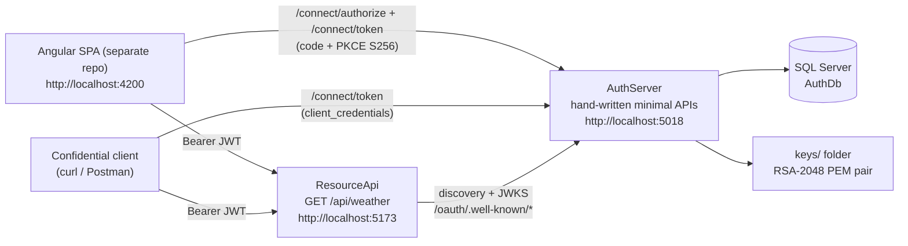
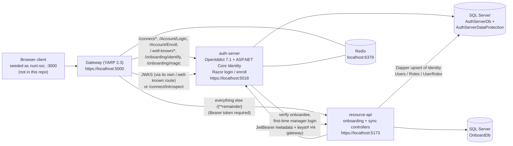
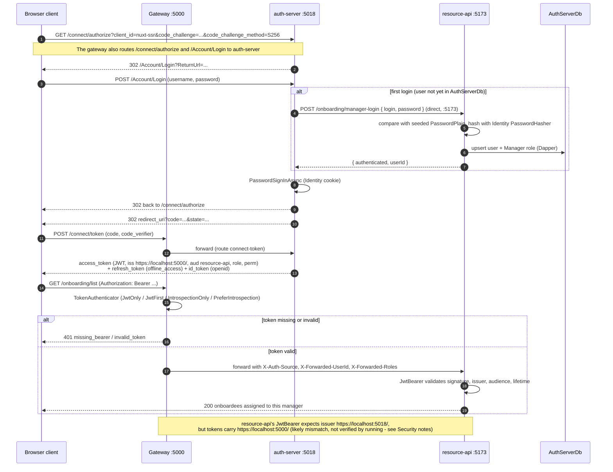

# oauth2-identity-lab


A two-generation lab for OAuth 2.0 on ASP.NET Core.

1. **Generation 1, `01-from-scratch/` (Sep 2025):** I wrote an authorization server by hand, with no OAuth library, so I could understand the protocol: authorization codes, PKCE, client credentials, refresh-token rotation with reuse detection, discovery, JWKS, and RFC 6750 bearer errors.
2. **Generation 2, `02-gateway-platform/` (Oct 2025):** I rebuilt it the way a real platform would. It uses a standards-compliant server library (OpenIddict on ASP.NET Core Identity) behind a YARP API gateway that validates tokens through JWKS or introspection. A resource API serves an employee onboarding scenario with passwordless enrollment.

> **Learning lab, not production.** Both generations take deliberate dev-only shortcuts, such as plaintext test passwords, disabled TLS validation and a token-debug endpoint that is not limited to Development. They are listed in [Security notes](#security-notes), each with what a production version would do instead.

The browser client for generation 1 is a separate repo: [oauth2-pkce-angular-client](https://github.com/HariVenkataKrishnaKotha/oauth2-pkce-angular-client), an Angular 20 app with hand-written PKCE.

---

## Contents

- [Architecture](#architecture)
- [What each part demonstrates](#what-each-part-demonstrates)
- [Generation 1 vs generation 2](#generation-1-vs-generation-2)
- [Prerequisites](#prerequisites)
- [Quick start: generation 1](#quick-start-generation-1)
- [Quick start: generation 2](#quick-start-generation-2)
- [Configuration reference](#configuration-reference)
- [Endpoints](#endpoints)
- [Security notes](#security-notes)
- [Tests](#tests)
- [Project structure](#project-structure)
- [Evaluated and chose not to use](#evaluated-and-chose-not-to-use)
- [Related repos](#related-repos)
- [License](#license)

---

## Architecture

### Generation 1: from scratch



### Generation 2: gateway platform



### Generation 2: main flow (manager sign-in, then an API call)



The gateway is the single, unified entry point. Specific routes send auth-server paths to auth-server, and a catch-all route (`api-routes`, `/{**remainder}`) sends everything else to resource-api. I designed it this way on purpose so every app goes through one entry route. I checked bottlenecks and bandwidth limits and found it sufficient for the number of apps it had to serve.

The gateway denies by default: every path needs a valid Bearer token except this short anonymous list:

| Anonymous at the gateway | Match | Why |
|---|---|---|
| `/onboarding/identify` | exact | auth-server step 1 of passwordless onboarding (last name + date of birth); the new hire has no token yet. Rate limited |
| `/onboarding/magic` | exact | auth-server step 2: redeems the one-time link and sets the auth-server cookie; still no token |
| `/connect/authorize`, `/connect/token`, `/connect/introspect`, `/connect/userinfo` | exact | OpenIddict endpoints; these authenticate callers themselves |
| `/Account/Login`, `/Account/Enroll` | exact | auth-server login and enrollment pages (cookie-based); both post back to the same path |
| `/.well-known/` | prefix | discovery document and JWKS (all public data) |
| `/health/live`, `/health/ready` | exact | the gateway's own probes |

The literal auth-server routes (such as `/onboarding/identify` and `/onboarding/magic`) and the gateway's own `/health/*` and `/test-token` endpoints take precedence over the catch-all. Everything that reaches resource-api through the catch-all, including `/onboarding/list`, `/internal/sync/*` and `/swagger`, needs a valid token at the gateway. See [Security notes](#security-notes) for what is still open.

---

## What each part demonstrates

| Part | Demonstrates | Key files |
|---|---|---|
| Gen 1 `AuthServer` | Authorization Code with PKCE (S256 required for public clients), Implicit explicitly rejected, client credentials (`client_secret_basic` and `client_secret_post`), opaque refresh tokens with rotation, family revocation on reuse and scope narrowing, RS256 JWT access tokens, hand-built discovery and JWKS documents, `no-store` token responses, PBKDF2-SHA256 secret hashing with constant-time compare | `Endpoints/*.cs`, `Logic/TokenService.cs`, `Security/RsaKeyStore.cs`, `Security/SecretHasher.cs` |
| Gen 1 `ResourceApi` | JWT bearer validation via discovery and JWKS, scope-based authorization policy, RFC 6750 `WWW-Authenticate` errors (`invalid_token` 401, `insufficient_scope` 403) | `Program.cs`, `Security/BearerErrors.cs`, `Security/ScopeRequirement.cs` |
| Gen 2 `auth-server` | OpenIddict 7.1 server on ASP.NET Core Identity (EF Core + SQL Server), PKCE-required code flow plus refresh, custom claims (`role`, `onboard_id`, `perm`) with per-token destinations, Razor login and enrollment pages, passwordless onboarding with one-time Redis verify sessions, Data Protection keys persisted to SQL | `Program.cs`, `Controllers/AuthorizationController.cs`, `Controllers/OnboardingController.cs`, `Services/MagicLinkService.cs`, `Infrastructure/Seed.cs` |
| Gen 2 `gateway` | YARP reverse proxy as the single entry point (auth-server routes plus a catch-all to resource-api) with a deny-by-default bearer check (anonymous only for the exact auth-server routes, the gateway's health probes and `/.well-known/`), a token authenticator with four validation modes (JWT via Redis-cached JWKS, OAuth introspection with Redis-cached results, and two fallback orders), JWKS cache invalidation and retry when the signing key changes, Redis fixed-window rate limiting for `/connect/*` and `/onboarding/identify`, security headers, hop-by-hop header stripping, identity forwarding headers, OpenTelemetry instrumentation | `Program.cs`, `Auth/TokenAuthenticator.cs`, `Auth/JwksProvider.cs`, `Auth/IntrospectionClient.cs`, `Auth/RedisRateLimiter.cs` |
| Gen 2 `resource-api` | JWT bearer validation against the auth server, role and permission-claim authorization (`ManagerOnly` policy + `perm=badge_approve`), manager-scoped data filtering, EF Core for onboarding data, provisioning users into the identity store | `Controllers/OnboardingController.cs`, `Controllers/SyncController.cs`, `Services/AuthServerSyncService.cs` |

---

## Generation 1 vs generation 2

| Aspect | Gen 1 (`01-from-scratch`) | Gen 2 (`02-gateway-platform`) |
|---|---|---|
| Authorization server | Hand-written minimal APIs | OpenIddict 7.1.0 (`OpenIddict.AspNetCore`, `.EntityFrameworkCore`) |
| User authentication | None: `/connect/authorize` issues codes for the seeded user `alice` | ASP.NET Core Identity, Razor `/Account/Login` and `/Account/Enroll` |
| Grants | Authorization code (+PKCE), client credentials, refresh token | Authorization code (PKCE required), refresh token |
| Signing keys | RSA-2048 key pair written as PEM to `AuthServer/keys/`, fixed `kid` `dev-rsa-1` | OpenIddict ephemeral signing and encryption keys, regenerated on every start |
| Access token | RS256 JWT, 10 min | JWT (access-token encryption disabled), 10 min |
| Refresh token | Opaque handle in SQL, rotation, family revoke on reuse, 30 days | OpenIddict-managed, 30 days |
| Discovery / JWKS | `/oauth/.well-known/openid-configuration`, `/oauth/.well-known/jwks.json` | OpenIddict defaults (the gateway uses `/.well-known/openid-configuration` and `/.well-known/jwks`) |
| Token validation | `JwtBearer` in the resource API | Gateway `TokenAuthenticator` (4 modes) plus `JwtBearer` in the resource API |
| Edge | None | YARP gateway, Redis rate limiting, security headers, OpenTelemetry |
| State | SQL Server | SQL Server (3 databases) + Redis + Data Protection keys in SQL |
| Transport | HTTP (issuer hard-coded to `http://localhost:5018`) | HTTPS (Identity cookie is `Secure`-only) |
| Browser client | Angular SPA, separate repo | Tested with Postman and the Brave browser. The seeded public client `nuxt-ssr` (`localhost:3000`) is for a Nuxt app I anticipated as a future client; it is not in this repo |
| Automated tests | None | None |

---

## Prerequisites

| Requirement | Used by | Notes |
|---|---|---|
| .NET 9 or .NET 10 SDK | All projects (`TargetFramework` is `net9.0`) | See the build status below |
| SQL Server or LocalDB | Both generations | Default connection strings use `Server=localhost` |
| Redis on `localhost:6379` | Gen 2 `auth-server` and `gateway` | Both connect at startup |
| Trusted ASP.NET Core dev certificate | Gen 2 (HTTPS) | `dotnet dev-certs https --trust` |
| Node.js + npm | Only the Angular SPA (separate repo) | |
| `dotnet-ef` tool | Optional, for manual migrations | `dotnet tool install --global dotnet-ef` |

**Build status (verified 2026-10-27):** all four (the gen 1 solution, `auth-server`, `gateway` and `resource-api`) build with 0 errors on SDK 10.0.301. `auth-server` was also built on SDK 9.0.315. No `global.json` or `LangVersion` override is needed.

---

## Quick start: generation 1

The sample commands use Windows authentication against a local SQL Server. Substitute your own connection string.

### 1. Database connection (dev secret)

`appsettings.json` ships with the placeholder `YOUR_SA_PASSWORD`. Override `ConnectionStrings:AuthDb` with user secrets. The project has no `UserSecretsId` yet, so `init` adds one to the csproj.

```powershell
cd 01-from-scratch/AuthServer
dotnet user-secrets init
dotnet user-secrets set "ConnectionStrings:AuthDb" "Server=localhost;Database=AuthDb;Trusted_Connection=True;TrustServerCertificate=True"
# LocalDB instead:
# dotnet user-secrets set "ConnectionStrings:AuthDb" "Server=(localdb)\MSSQLLocalDB;Database=AuthDb;Trusted_Connection=True;TrustServerCertificate=True"
```

Or use an environment variable:

```powershell
$env:ConnectionStrings__AuthDb = "Server=localhost;Database=AuthDb;Trusted_Connection=True;TrustServerCertificate=True"
```

```bash
export ConnectionStrings__AuthDb="Server=localhost;Database=AuthDb;User Id=sa;Password=<your-password>;TrustServerCertificate=True"
```

### 2. Migrations

`AuthServer` applies its EF Core migrations and seeds data on startup (`Database.MigrateAsync()` + `DbSeeder`). To apply them by hand, set the **environment variable**, not user secrets: the design-time factory (`Infrastructure/AuthDbContextFactory.cs`) reads only `appsettings.json` and environment variables.

```powershell
cd 01-from-scratch/AuthServer
dotnet ef database update
```

### 3. Run (use the `http` profile; the issuer is hard-coded to `http://localhost:5018`)

```powershell
# terminal 1
cd 01-from-scratch/AuthServer
dotnet run --launch-profile http      # http://localhost:5018

# terminal 2
cd 01-from-scratch/ResourceApi
dotnet run --launch-profile http      # http://localhost:5173
```

Start `AuthServer` first: `ResourceApi` reads the discovery document from it.

### 4. Try client credentials (no browser needed)

The seeder registers a confidential client `demo-spa` with the dev secret `svc-secret-very-strong` and scope `weather.read`.

```bash
curl -s -X POST http://localhost:5018/connect/token \
  -u demo-spa:svc-secret-very-strong \
  -d grant_type=client_credentials -d scope=weather.read

curl -s http://localhost:5173/api/weather -H "Authorization: Bearer <access_token>"
```

In PowerShell, call `curl.exe` with the same arguments on one line, or replace `\` with a backtick.

### 5. Point the Angular SPA at it

The SPA's `src/environments/environment.ts` already targets generation 1: issuer `http://localhost:5018`, `clientId` `demo-spa`, redirect `http://localhost:4200/callback`, scope `weather.read` and `resourceApi` `http://localhost:5173`. The AuthServer and ResourceApi CORS policies allow `http://localhost:4200`.

```bash
git clone https://github.com/HariVenkataKrishnaKotha/oauth2-pkce-angular-client
cd oauth2-pkce-angular-client
npm install
npx ng serve      # http://localhost:4200
```

**Existing databases.** `DbSeeder.cs` seeds `demo-spa`'s redirect URIs as the JSON array `["http://localhost:4200/callback"]`, which is what `/connect/authorize` parses. Older versions stored the plain string `localhost:4200/callback`, and the seeder skips `demo-spa` once the row exists. If your `AuthDb` was created before this fix, browser sign-in will still fail. Delete the row and restart `AuthServer` so it is seeded again, or drop and recreate the database:

```sql
DELETE FROM OAuthClients WHERE ClientId = N'demo-spa';
```

---

## Quick start: generation 2

### 1. Infrastructure

```bash
# Redis (any local Redis on 6379 works; Docker shown as one option)
docker run -d --name redis -p 6379:6379 redis:7

# HTTPS dev certificate
dotnet dev-certs https --trust
```

### 2. Dev secrets

The committed `appsettings.json` files contain placeholders: `YOUR_SA_PASSWORD` in the SQL connection strings and `dev-only-change-me` for the gateway's OAuth client secret. Override them per project:

```powershell
cd 02-gateway-platform/auth-server
dotnet user-secrets init
dotnet user-secrets set "ConnectionStrings:Default"        "Server=localhost;Database=AuthServerDb;Trusted_Connection=True;TrustServerCertificate=True"
dotnet user-secrets set "ConnectionStrings:DataProtection" "Server=localhost;Database=AuthServerDataProtection;Trusted_Connection=True;TrustServerCertificate=True"

cd ../resource-api
dotnet user-secrets init
dotnet user-secrets set "ConnectionStrings:OnboardingDb" "Server=localhost;Database=OnboardDb;Trusted_Connection=True;TrustServerCertificate=True"
dotnet user-secrets set "ConnectionStrings:AuthServerDb" "Server=localhost;Database=AuthServerDb;Trusted_Connection=True;TrustServerCertificate=True"

cd ../gateway
dotnet user-secrets init
dotnet user-secrets set "Gateway:Introspection:ClientSecret" "<same value as the yarp-gateway secret in auth-server>"
```

Environment-variable form (bash):

```bash
export ConnectionStrings__Default="Server=localhost;Database=AuthServerDb;User Id=sa;Password=<your-password>;TrustServerCertificate=True"
export ConnectionStrings__DataProtection="Server=localhost;Database=AuthServerDataProtection;User Id=sa;Password=<your-password>;TrustServerCertificate=True"
export ConnectionStrings__OnboardingDb="Server=localhost;Database=OnboardDb;User Id=sa;Password=<your-password>;TrustServerCertificate=True"
export ConnectionStrings__AuthServerDb="Server=localhost;Database=AuthServerDb;User Id=sa;Password=<your-password>;TrustServerCertificate=True"
export Gateway__Introspection__ClientSecret="<same value as the yarp-gateway secret in auth-server>"
```

> `ConnectionStrings:AuthServerDb` (resource-api) must point at the **same database** as `ConnectionStrings:Default` (auth-server), because resource-api writes Identity users into it directly.
>
> The `yarp-gateway` client secret is a literal in `auth-server/Infrastructure/Seed.cs`, not a configuration key. Seeding runs only when the client does not exist yet. To use a different secret, change it in code before the first run, or update the stored client afterwards. The gateway only uses this secret in the introspection validation modes; the committed default mode is `JwtOnly`.

### 3. Databases

- `auth-server` applies its migrations on startup for both `ApplicationDbContext` and `DataProtectionKeyContext`.
- `resource-api` calls `Database.EnsureCreatedAsync()` on startup and seeds two managers and three onboardees.

To apply the auth-server migrations by hand:

```powershell
cd 02-gateway-platform/auth-server
dotnet ef database update --context ApplicationDbContext
dotnet ef database update --context DataProtectionKeyContext
```

Do not mix `dotnet ef database update` with the `EnsureCreated` path for `resource-api`. Pick one per database.

### 4. Run order

Every project's **first** launch profile is `http`, so pass `--launch-profile https` to get the ports the code expects.

```powershell
# 1. Redis must already be running on localhost:6379

# 2. auth-server: creates AuthServerDb, which resource-api writes into
cd 02-gateway-platform/auth-server
dotnet run --launch-profile https      # https://localhost:5018 (http 5019)

# 3. resource-api
cd 02-gateway-platform/resource-api
dotnet run --launch-profile https      # https://localhost:5173 (http 5174), Swagger at /swagger

# 4. gateway
cd 02-gateway-platform/gateway
dotnet run --launch-profile https      # https://localhost:5000 (http 5001)
```

### 5. Walk through the manager flow without a browser client

The seeded public client is `nuxt-ssr`, with redirect URI `https://localhost:3000/auth/callback` and scopes `openid email profile offline_access onboarding.read onboarding.write`. You can drive it by hand with a browser and curl.

**Create a PKCE pair.** In PowerShell:

```powershell
$bytes = New-Object byte[] 32
[System.Security.Cryptography.RandomNumberGenerator]::Create().GetBytes($bytes)
$verifier  = [Convert]::ToBase64String($bytes).TrimEnd('=').Replace('+','-').Replace('/','_')
$hash      = [System.Security.Cryptography.SHA256]::Create().ComputeHash([Text.Encoding]::ASCII.GetBytes($verifier))
$challenge = [Convert]::ToBase64String($hash).TrimEnd('=').Replace('+','-').Replace('/','_')
"verifier=$verifier"; "challenge=$challenge"
```

In bash:

```bash
verifier=$(openssl rand -base64 32 | tr '+/' '-_' | tr -d '=\n')
challenge=$(printf '%s' "$verifier" | openssl dgst -sha256 -binary | openssl base64 -A | tr '+/' '-_' | tr -d '=')
echo "verifier=$verifier"; echo "challenge=$challenge"
```

**Authorize.** Open this URL in a private browser window:

```
https://localhost:5018/connect/authorize?client_id=nuxt-ssr&response_type=code&redirect_uri=https://localhost:3000/auth/callback&scope=openid%20profile%20email%20offline_access%20onboarding.read%20onboarding.write&state=demo123&code_challenge=<challenge>&code_challenge_method=S256
```

Sign in as the seeded manager `manager1@example.com` / `P@ssw0rd!123`. The browser lands on `https://localhost:3000/auth/callback?code=...`. The page will not load unless a client is running there, so copy the `code` from the address bar.

**Exchange the code:**

```bash
curl -s https://localhost:5018/connect/token \
  -d grant_type=authorization_code -d client_id=nuxt-ssr \
  -d redirect_uri=https://localhost:3000/auth/callback \
  -d code=<code> -d code_verifier=<verifier>
```

**Call the API through the gateway:**

```bash
# validated by the gateway's TokenAuthenticator, then by resource-api's JwtBearer
# (see the issuer-mismatch row in Security notes if resource-api returns 401)
curl -s https://localhost:5000/onboarding/list -H "Authorization: Bearer <access_token>"

# validated by the gateway's TokenAuthenticator; echoes the source (jwt / introspection) and claims (dev-only endpoint)
curl -s https://localhost:5000/test-token -H "Authorization: Bearer <access_token>"
```

The passwordless onboarding flow (`/onboarding/identify` then `/onboarding/magic` then `/Account/Enroll`) is described in [02-gateway-platform/README.md](02-gateway-platform/README.md).

### 6. Pointing a browser client at it

A browser client must:

- run at `https://localhost:3000` or `http://localhost:3000`: those are the gateway CORS origins and the seeded `nuxt-ssr` redirect URIs;
- use `client_id=nuxt-ssr` and redirect to `/auth/callback`;
- use PKCE S256.

The Angular SPA in [oauth2-pkce-angular-client](https://github.com/HariVenkataKrishnaKotha/oauth2-pkce-angular-client) targets generation 1. To use it here, you would register a matching client in `auth-server/Infrastructure/Seed.cs` and add its origin to the gateway's CORS policy, and the SPA's discovery URL would need to change, because it appends `/oauth/.well-known/openid-configuration`, which is a gen-1 path.

I tested generation 2 with Postman and the Brave browser. The `nuxt-ssr` client is seeded, and the gateway's CORS policy allows port 3000, because the proof of concept anticipated a Nuxt app as a future client. That app is not in this repo.

---

## Configuration reference

Keys are listed as JSON paths. For environment variables, replace `:` with `__`.

### Generation 1

| Project | Key | Default in repo | Used by |
|---|---|---|---|
| AuthServer | `ConnectionStrings:AuthDb` | `Server=localhost;Database=AuthDb;User Id=sa;Password=YOUR_SA_PASSWORD;Trusted_Connection=True;TrustServerCertificate=True` | `Program.cs`, `AuthDbContextFactory.cs` |

These values are hard-coded rather than configured: issuer `http://localhost:5018`, audience `resource-api`, access-token lifetime 10 min, refresh-token lifetime 30 days (`AuthServer/Program.cs`, `DiscoveryEndpoints.cs`, `ResourceApi/Program.cs`); CORS origins `http://localhost:4200` and `http://127.0.0.1:4200`; key folder `AuthServer/keys/` (gitignored).

### Generation 2

| Project | Key | Default in repo | Notes |
|---|---|---|---|
| auth-server | `ConnectionStrings:Default` | `...Database=AuthServerDb;User Id=sa;Password=YOUR_SA_PASSWORD...` | Identity + OpenIddict store |
| auth-server | `ConnectionStrings:DataProtection` | `...Database=AuthServerDataProtection;User Id=sa;Password=YOUR_SA_PASSWORD...` | Data Protection key ring |
| auth-server | `OpenIddict:Issuer` | `https://localhost:5000/` | The gateway URL; must equal the gateway's `Gateway:Issuer` |
| auth-server | `Redis:Configuration` | `localhost:6379` | Verify sessions, identify rate limit |
| auth-server | `ResourceAPI:BaseUrl` | `https://localhost:5173` | Present in config but **not read** by the code (URLs are hard-coded in `Program.cs` and `ResourceApiClient.cs`) |
| gateway | `Gateway:Issuer` | `https://localhost:5000/` | Required; validated `iss` |
| gateway | `Gateway:ExpectedAudiences` | `["resource-api"]` | Audience validation on when non-empty |
| gateway | `Gateway:JwksUri` | `https://localhost:5000/.well-known/jwks` | Fetched through the gateway's own `well-known` route |
| gateway | `Gateway:ValidationMode` | `JwtOnly` | `JwtOnly`, `JwtFirst` (code default when unset), `IntrospectionOnly`, `PreferIntrospection` |
| gateway | `Gateway:TokenClockSkewSeconds` | `60` | |
| gateway | `Gateway:Introspection:Endpoint` | `https://localhost:5018/connect/introspect` | Direct to auth-server |
| gateway | `Gateway:Introspection:ClientId` | `yarp-gateway` | |
| gateway | `Gateway:Introspection:ClientSecret` | `dev-only-change-me` | Dev secret; set via user secrets or env var |
| gateway | `Redis:Configuration` | `localhost:6379` | Multiplexer + distributed cache |
| gateway | `Redis:IntrospectionCachePrefix` | `introspect:` | |
| gateway | `RateLimiting:AuthWindowSeconds` / `AuthMax` | `60` / `60` | `/connect/*` per IP |
| gateway | `RateLimiting:IdentifyWindowSeconds` / `IdentifyMax` | `300` / `20` | `/onboarding/identify` per IP |
| gateway | `ReverseProxy:Routes`, `ReverseProxy:Clusters` | see `appsettings.json` | YARP routes and the `auth` / `resourceapi` clusters |
| gateway | `Gateway:DiscoveryUrl`, `Redis:JwksCacheKey`, `Redis:JwksCacheSeconds` | | Present in config but **not read**; `JwksProvider` uses cache key `jwks` and a 1-hour TTL |
| resource-api | `ConnectionStrings:OnboardingDb` | `...Database=OnboardDb;User Id=sa;Password=YOUR_SA_PASSWORD...` | Managers, onboardees |
| resource-api | `ConnectionStrings:AuthServerDb` | `...Database=AuthServerDb;User Id=sa;Password=YOUR_SA_PASSWORD...` | Same database as auth-server `Default` |

`resource-api` hard-codes `Authority` and `ValidIssuer` as `https://localhost:5018/` and `Audience` as `resource-api` in `Program.cs`. The disabled mTLS forwarder (`gateway/Infrastructure/MtlsForwarderHttpClientFactory.cs`, commented out in `Program.cs`) would read the YARP cluster metadata keys `ClientCertPath` and `ClientCertPassword`.

---

## Endpoints

### Generation 1: AuthServer (`http://localhost:5018`)

| Method | Path | Notes |
|---|---|---|
| GET | `/connect/authorize` | `response_type=code` only; `token` (Implicit) is rejected. PKCE S256 required for public clients |
| POST | `/connect/token` | `authorization_code`, `client_credentials`, `refresh_token`. Form-encoded only |
| GET | `/oauth/.well-known/openid-configuration` | Hand-built metadata |
| GET | `/oauth/.well-known/jwks.json` | One RSA key, `kid` `dev-rsa-1` |
| GET | `/admin/clients/` | Loopback callers only |
| POST | `/admin/clients/register` | Loopback only; returns a generated `client_id` (and secret for confidential clients) |
| POST | `/admin/clients/{clientId}/rotate-secret` | Loopback only |
| GET | `/health` | |
| GET | `/swagger` | Development environment only |

### Generation 1: ResourceApi (`http://localhost:5173`)

| Method | Path | Notes |
|---|---|---|
| GET | `/api/weather` | Requires scope `weather.read`; 401 and 403 carry RFC 6750 `WWW-Authenticate` |
| GET | `/health` | |
| GET | `/swagger` | Development only |

### Generation 2

The per-service endpoint tables are in [02-gateway-platform/README.md](02-gateway-platform/README.md#endpoints). In summary:

- **auth-server:** `/connect/authorize`, `/connect/token` (controller passthrough), plus `/connect/introspect`, `/connect/revocation`, `/connect/endsession` and `/connect/userinfo`, which are configured in OpenIddict; also `/Account/Login`, `/Account/Enroll`, `/onboarding/identify`, `/onboarding/magic`, `/health/ready` and `/health/redis`.
- **gateway:** the YARP routes, plus `/test-token`, `/health/live` and `/health/ready`. Every path needs a Bearer token except the [anonymous list](#generation-2-main-flow-manager-sign-in-then-an-api-call) above.
- **resource-api:** `GET /onboarding/verify`, `POST /onboarding/manager-login` (JSON body), `/onboarding/list`, `/onboarding/{id}`, `/onboarding/{id}/badge-approval`, `/internal/sync/manager`, `/internal/sync/onboardee` and `/health/ready`. Through the gateway's catch-all, every resource-api endpoint is reachable with a valid token, and none without one.

---

## Security notes

This is a **learning lab, not production code**. The shortcuts below are in the code on purpose, so each flow can be run and inspected locally. Each row says what a production system would do instead.

### Generation 1

| Shortcut in the code | Where | Production approach |
|---|---|---|
| No end-user login or consent: every authorization code is issued for the seeded user `alice` (the `ResourceOwnerConsents` table is never used) | `Endpoints/AuthorizeEndpoint.cs`, `Logic/DevUser.cs` | Authenticate the resource owner and record consent before issuing a code |
| Seeded test credentials in source: user `alice` / `P@ssw0rd!`; client `demo-spa` / `svc-secret-very-strong` (both stored as PBKDF2 hashes) | `Infrastructure/DbSeeder.cs` | No seeded accounts; client secrets issued at registration and kept in a secret store |
| HTTP only; issuer hard-coded to `http://localhost:5018` in three places; `RequireHttpsMetadata = false` | `AuthServer/Program.cs`, `DiscoveryEndpoints.cs`, `ResourceApi/Program.cs` | HTTPS everywhere; issuer from configuration |
| RSA private key written unencrypted to `AuthServer/keys/` (gitignored), one fixed `kid`, no rotation | `Security/RsaKeyStore.cs` | Keys in an HSM or Key Vault, scheduled rotation, old and new keys published side by side in JWKS |
| Raw bearer tokens and `Authorization` headers written to the console; `IdentityModelEventSource.ShowPII = true` in Development | `ResourceApi/Program.cs` | Never log tokens; keep PII logging off |
| Admin client-registration endpoints protected only by a loopback IP check | `Endpoints/AdminClientsEndpoints.cs` | Authenticated admin API or protected dynamic client registration (RFC 7591) |
| `plain` PKCE accepted for confidential clients and advertised in discovery | `AuthorizeEndpoint.cs`, `DiscoveryEndpoints.cs` | S256 only |
| `demo-spa`, the client the Angular SPA uses, is seeded as a **confidential** client with a secret (display name "Weather Reporter Service"). The server only requires PKCE for public clients, so it does not enforce PKCE for the SPA, and `plain` is accepted | `Infrastructure/DbSeeder.cs`, `Endpoints/AuthorizeEndpoint.cs` | Register the browser app as a public client with no secret and require PKCE S256; use a separate confidential client for client credentials |
| The token endpoint does not authenticate confidential clients on `authorization_code` or `refresh_token`, and does not check that a refresh token belongs to the calling client | `Endpoints/TokenEndpoint.cs`, `Logic/TokenService.cs` | Client authentication on every grant for confidential clients; bind refresh tokens to the client |

### Generation 2

| Shortcut in the code | Where | Production approach |
|---|---|---|
| **`PasswordPlain`** test field: manager passwords stored and compared in plaintext | `resource-api/Data/Entities.cs`, `Controllers/OnboardingController.cs`, `Controllers/SyncController.cs` | No plaintext passwords; federate to the system of record or migrate users with hashed credentials |
| **Seeded test users:** `manager1@example.com` and `manager2@example.com` (`P@ssw0rd!123`), onboardees Ava Johnson, Liam Johnson and Maya Patel | `resource-api/Data/Seed.cs` | No seed data outside local dev |
| **Unauthenticated internal endpoints on resource-api.** `GET /onboarding/verify`, `POST /onboarding/manager-login` and `POST /internal/sync/*` are `[AllowAnonymous]`. The auth-server calls verify and manager-login directly on `https://localhost:5173` with no service credentials. Anyone who can reach port 5173 can call all of them. Through the gateway's catch-all, all of them (and resource-api's `/swagger`) are reachable by any caller with a valid token, with no role or scope check. Any onboardee's token is enough, for example to call `/internal/sync/manager` | `resource-api/Controllers/OnboardingController.cs`, `Controllers/SyncController.cs`, `auth-server/Services/ResourceApiClient.cs`, `auth-server/Pages/Account/Login.cshtml.cs`, `gateway/appsettings.json` | Service-to-service authentication (client-credentials token or mTLS) on these endpoints, keep them off the public network, and exclude internal paths from the gateway's catch-all or protect them with a gateway policy |
| **TLS validation bypassed:** `ServerCertificateCustomValidationCallback => true` (auth-server HttpClients, gateway JWKS and introspection clients, resource-api JwtBearer backchannel) and YARP `DangerousAcceptAnyServerCertificate: true` on both clusters | `auth-server/Program.cs`, `gateway/Program.cs`, `resource-api/Program.cs`, `gateway/appsettings.json` | Trusted certificates; validation always on |
| OpenIddict `DisableTransportSecurityRequirement()` | `auth-server/Program.cs` | Remove, so HTTPS is enforced |
| Ephemeral signing and encryption keys: every token becomes invalid when auth-server restarts | `auth-server/Program.cs` | Persisted X.509 signing and encryption certificates with rotation |
| **`/test-token`** debug endpoint on the gateway (commented "bypass all auth"), not environment-gated. It echoes the validation source and every claim of the presented token. Invalid or missing tokens are stopped earlier by the gateway's bearer middleware | `gateway/Program.cs` | Remove, or map only in Development |
| **The gateway checks that a token is valid, not what it allows.** The policies `ApiDefault` (scope `onboarding.read`) and `ManagerWrite` (scope `onboarding.write`, role `Manager`, `perm=badge_approve`) are defined, but there is no `UseAuthorization()` and no route sets an `AuthorizationPolicy`. `GatewayAuthenticationHandler` is not registered. Scope and role checks happen only in resource-api (`[Authorize]`, `ManagerOnly`) | `gateway/Program.cs`, `gateway/appsettings.json`, `gateway/Auth/GatewayAuthenticationHandler.cs` | Register the authentication scheme, call `UseAuthorization()`, and set an `AuthorizationPolicy` on each YARP route |
| **Likely issuer mismatch (not verified by running).** auth-server issues tokens with issuer `https://localhost:5000/` (the gateway, from `OpenIddict:Issuer`). resource-api's `JwtBearer` hard-codes `Authority` and `ValidIssuer` as `https://localhost:5018/`. If so, resource-api will reject the gateway-validated tokens with 401 | `auth-server/appsettings.json`, `resource-api/Program.cs` | Read the issuer and authority from configuration, with one value shared by every service |
| resource-api writes rows straight into the auth server's Identity tables with Dapper | `resource-api/Services/AuthServerSyncService.cs` | A provisioning API on the identity service (client-credentials protected) or SCIM; no cross-service database writes |
| Hard-coded `yarp-gateway` client secret `dev-only-change-me` (seed) mirrored in gateway config | `auth-server/Infrastructure/Seed.cs`, `gateway/appsettings.json` | Secret from a vault, configured on both sides |
| Passwordless identify returns the verify-session id **in the API response** instead of delivering a link out-of-band (marked TODO); identity proofing is last name + date of birth | `auth-server/Controllers/OnboardingController.cs` | Send the link to a verified email or phone and never return it to the caller; stronger identity proofing |
| `/Account/Enroll` redirects to `ReturnUrl` without a local-URL check, and marks the email as confirmed automatically | `auth-server/Pages/Account/Enroll.cshtml.cs` | `Url.IsLocalUrl` / `LocalRedirect`; real email confirmation |
| Lockout configured (`MaxFailedAccessAttempts = 5`) but sign-in uses `lockoutOnFailure: false` | `auth-server/Pages/Account/Login.cshtml.cs` | `lockoutOnFailure: true` |
| `GET /onboarding/{id}` returns any onboardee to any authenticated caller; badge approval does not check that the onboardee belongs to the manager | `resource-api/Controllers/OnboardingController.cs` | Resource-level authorization (ownership checks) |
| Introspection results cached in Redis under a key that contains the raw token | `gateway/Auth/IntrospectionClient.cs` | Key the cache by a hash of the token |
| Swagger UI is on in every environment | `resource-api/Program.cs` | Development only |

---

## Tests

There are **no automated tests** in either generation and no CI workflow. The `.http` files in each project are the default scaffold templates: they call `/weatherforecast`, which these projects do not expose. Verification so far is manual (curl, Postman and the browser walkthroughs above).

What was verified for this README (2026-10-27): `dotnet build` passes with 0 errors for all four solutions/projects on SDK 10.0.301, and for `auth-server` on SDK 9.0.315, as described under [Prerequisites](#prerequisites). The applications were not run against a database for this check.

---

## Project structure

```
oauth2-identity-lab/
├── 01-from-scratch/                  # Generation 1 (OAuthFromScratch.sln)
│   ├── AuthServer/                   # hand-written authorization server
│   │   ├── Endpoints/                # authorize, token, discovery, admin clients
│   │   ├── Logic/                    # TokenService, validation, helpers
│   │   ├── Security/                 # RSA key store, secret hashing, scope policy
│   │   ├── Infrastructure/           # AuthDbContext, design-time factory, seeder
│   │   ├── Domain/Entities.cs
│   │   └── Migrations/
│   └── ResourceApi/                  # protected API (/api/weather)
│       ├── Security/                 # RFC 6750 errors, scope requirement
│       └── Services/                 # JwksProvider, JwksRefreshService (not registered)
├── 02-gateway-platform/              # Generation 2 (one .sln per service)
│   ├── auth-server/                  # OpenIddict + Identity + Razor pages
│   │   ├── Controllers/              # Authorization, Onboarding, Account
│   │   ├── Pages/Account/            # Login, Enroll
│   │   ├── Services/                 # magic-link sessions (Redis), resource-api client
│   │   ├── Data/                     # ApplicationDbContext, DataProtectionKeyContext, migrations
│   │   └── Infrastructure/Seed.cs    # roles, clients, scopes
│   ├── gateway/                      # YARP gateway
│   │   ├── Auth/                     # TokenAuthenticator, JWKS, introspection, rate limiter
│   │   ├── Policies/                 # scope requirement and handler
│   │   ├── Transforms/               # forwarded identity headers
│   │   └── Infrastructure/           # mTLS forwarder factory (disabled), problem helper
│   └── resource-api/                 # onboarding API
│       ├── Controllers/              # Onboarding, Sync
│       ├── Data/                     # OnboardingDbContext, entities, seed
│       ├── Services/                 # AuthServerSyncService (Dapper), PasswordHashing
│       └── Migrations/
└── LICENSE                           # Apache-2.0
```

---

## Evaluated and chose not to use

Only decisions visible in the code or its history, or that I made deliberately, are listed here.

| Not used | Evidence | Reason |
|---|---|---|
| Implicit grant (`response_type=token`) | Gen 1 `AuthorizeEndpoint.cs` rejects it explicitly with `unsupported_response_type` | Deprecated by OAuth 2.0 security best practice; tokens in the front channel |
| Access-token encryption | Gen 2 `DisableAccessTokenEncryption()` | Keeps access tokens as signed JWTs that the gateway and API can validate locally through JWKS |
| Prefix routing (`/auth/**`, `/api/**` with `PathRemovePrefix` and route `AuthorizationPolicy`) | Present in the Oct 2025 gateway config. Replaced by explicit auth-server routes plus one catch-all route, `/{**remainder}`, to resource-api | I wanted the gateway to be one unified entry route that every app goes through. I checked bottlenecks and bandwidth limits and found it sufficient for the number of apps it had to serve. Token checks stay deny-by-default with a short anonymous list |
| Duende IdentityServer, Keycloak or Entra ID as the authorization server; Ocelot or Azure API Management as the gateway | Gen 2 uses OpenIddict 7.1 and YARP 2.3 | I wanted open-source, customizable components with no commercial or licensing hurdles. YARP is the most natural gateway fit for .NET and C# |

---

## Related repos

- [oauth2-pkce-angular-client](https://github.com/HariVenkataKrishnaKotha/oauth2-pkce-angular-client): an Angular 20 SPA with hand-written PKCE that serves as the browser client for generation 1.
- [DesiCorner](https://github.com/HariVenkataKrishnaKotha/DesiCorner): a restaurant e-commerce platform built as .NET 8 microservices.

---

## License

[Apache License 2.0](LICENSE)
